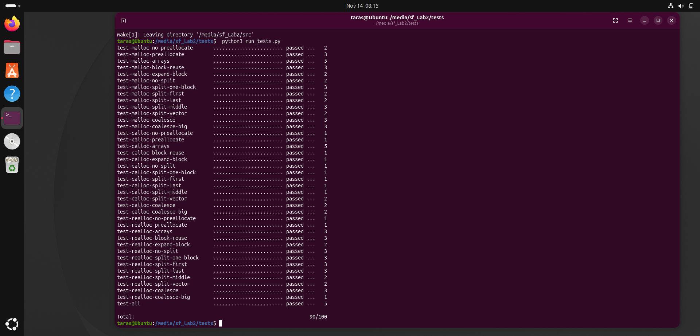
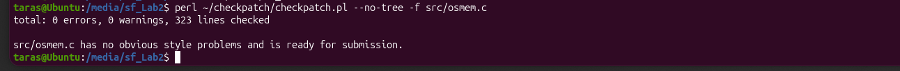

# Memory Allocator

A minimal implementation of `malloc()`, `calloc()`, `realloc()` and `free()` in C,
built as the shared library `libosmem.so` on top of the Linux syscalls `brk()`/`sbrk()`,
`mmap()` and `munmap()`.

Operating Systems course, Lab 2. Assignment: [`docs/README.md`](docs/README.md)
(from [open-education-hub/operating-systems](https://github.com/open-education-hub/operating-systems/tree/main/content/assignments/memory-allocator)).

## Results

All 40 official tests pass (90/90 test points, run with the valgrind memory-leak check):



Coding style checked with the Linux kernel `checkpatch.pl`:



## API

| Function | Behaviour |
|---|---|
| `void *os_malloc(size_t size)` | Allocates `size` bytes. `0` → `NULL`. |
| `void *os_calloc(size_t nmemb, size_t size)` | Allocates a zero-filled array; `NULL` if either argument is `0` or the product overflows. |
| `void *os_realloc(void *ptr, size_t size)` | Resizes a block, in place when possible. `NULL` ptr → `malloc`, size `0` → `free`, already freed block → `NULL`. |
| `void os_free(void *ptr)` | Releases a block: heap blocks are kept for reuse, mapped blocks are unmapped. |

## Design

Every block starts with a header (`struct block_meta`, 32 bytes) followed by the payload;
the user receives the payload address. All sizes and addresses are aligned to 8 bytes.

```
 block                      returned pointer (block + 32)
   │                           │
   ▼                           ▼
   ┌───────────────────────────┬─────────────────────────┐
   │ size | status | prev|next │ payload (multiple of 8) │
   └───────────────────────────┴─────────────────────────┘
```

**Where memory comes from**

- Blocks with `header + size >= 128 KiB` (one page, 4096 bytes, for `calloc`) get their own
  zone from `mmap()` and are returned to the OS with `munmap()` on free.
- Smaller blocks live on the heap. The first heap allocation preallocates 128 KiB with a single
  `sbrk()`; heap memory is never returned to the OS, freed blocks are reused.

**Heap management** (all heap blocks are kept in a doubly linked list, in address order)

1. **Coalesce** — before every search, neighbouring free blocks are merged (less external fragmentation).
2. **Best fit** — the smallest free block that is big enough is chosen.
3. **Split** — if the chosen block leaves at least `32 + 8` bytes, the tail becomes a new free block
   (less internal fragmentation).
4. **Expand last block** — if nothing fits but the last block is free, the heap grows only by the missing bytes.
5. Otherwise a new block is appended at the end of the heap with `sbrk()`.

**`os_realloc`** keeps the block in place when it shrinks, when it is the last heap block
(grows with `sbrk()`), or when merging the free blocks after it — one at a time — makes it big enough.
Otherwise (and always for mapped blocks or sizes above the threshold) the data is copied to a new block.

Every syscall result is checked with the `DIE()` macro.

## Repository layout

```
src/osmem.c      allocator implementation
src/Makefile     builds src/libosmem.so
utils/           library interface, struct block_meta, heap-free printf (support code)
tests/           official test suite: snippets, reference outputs, run_tests.py (support code)
docs/            assignment text, images, screenshots
```

## Build and test

Requirements (Ubuntu): `gcc make python3 ltrace valgrind`.

```sh
cd src && make                 # builds libosmem.so
cd ../tests
make                           # builds the library and the test programs
python3 run_tests.py           # all tests, with memory-leak check (valgrind)
python3 run_tests.py -d        # faster, no valgrind; shows a diff for failed tests
python3 run_tests.py test-all  # a single test
```

`run_tests.py` traces each test program with `ltrace` and compares the exact sequence of
`brk`/`mmap`/`munmap` calls with the reference in `tests/ref/`. Run it from the `tests/` directory.

## Credits

The support code (`utils/`, `tests/`, `src/Makefile`) and the assignment text come from the
open-education-hub Operating Systems course, BSD-3-Clause — see [`NOTICE.md`](NOTICE.md).
